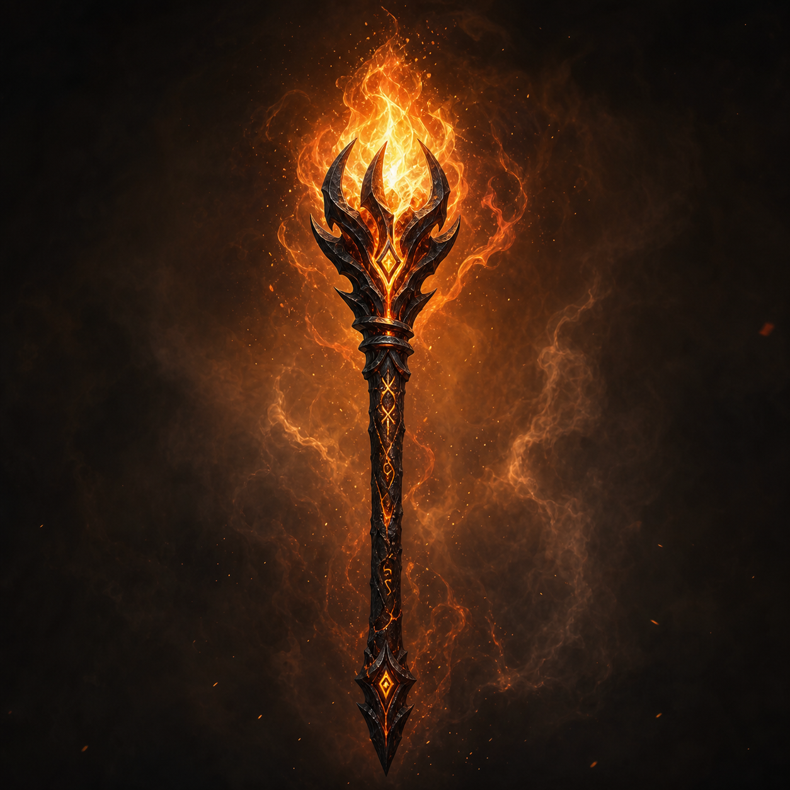

# Firestaff

Firestaff is a clean-room engine for the Dungeon Master games. It reads the
original files you own, identifies each edition by its content hash and keeps
that data separate from the program.

Firestaff has bounded native routes for Dungeon Master, Chaos Strikes Back,
Dungeon Master II: Skullkeep and Theron's Quest using verified original media.
Nexus is available in the launcher and has Saturn data and asset support, but
does not yet reach playable gameplay through Firestaff. Coverage is deliberately
conservative: a route is available only when the selected edition has a
verified native handoff. Full campaign, save and visual parity remain active
work, especially for Chaos Strikes Back, Nexus and Theron's Quest.

[](https://github.com/yeager/firestaff/actions/workflows/verify.yml)
[](LICENSE)

<p align="center">
  
</p>

## Current status

The status pages were reviewed on 2026-10-31 for the v3.0.422 candidate. The
latest full five-card authentic-media selection check verified keyboard and
mouse selection plus default-root handoff for DM1, CSB, DM2, Nexus and Theron.
Separate real-media runtime checks reached Firestaff gameplay for DM1, CSB,
DM2 and Theron's Quest. Candidate Nexus tests verified JP/EN extracted-owner
selection and matching supplemental-disc binding, but Nexus still stops at its
Saturn title compositor gate and is not a playable route. These SDL dummy and
CLI checks do not verify native display, audio, or physical input, and do not
establish complete game parity.

Firestaff detects real media and exposes paths only after their handoff gates
pass. Edition ownership is checked per route. Extracted Nexus JP/EN/FR owners
now use regional identity hashes, and supplemental discs must match the owner;
authentic JP and EN menu checks passed. The authentic Japanese retail CUE/BIN
layout is admitted through direct CLI and start-menu routes while retaining
the selected CUE as its media owner. Nexus still stops at the title compositor
gate and is not playable. The detailed status is kept in
[project status](docs/PROJECT_STATUS.md). The published documentation is
available at [yeager.github.io/firestaff](https://yeager.github.io/firestaff/).
The [preservation status](docs/PRESERVATION_STATUS_2026-08-11.md) is a dated
2026-08-12 snapshot; use the current status pages for today's support boundary.

| Game | Current scope |
|---|---|
| Dungeon Master | PC DOS, Atari ST, Amiga and FM Towns startup and selected dungeon routes have real-media coverage. The PC 3.4 Hall of Champions candidate panel is rendered from authenticated C040/C026 assets. Further gameplay and visual parity work continues. |
| Chaos Strikes Back | Atari ST, Amiga and FM Towns have bounded real-media runtime routes. FM Towns uses its authenticated entrance palette and MINI.DAT bootstrap state. Amiga F0107 wall ornaments now use source MEDIA720 scales and authentic C696 anchors; matched-frame, palette/light, inscription readability, floor trapdoor, intro timing and audible output remain open. Campaign and save coverage are also incomplete. |
| Dungeon Master II: Skullkeep | DOS, Amiga, FM Towns and Macintosh have real-media startup and selected runtime coverage. Amiga reaches its initial GDAT-backed M11 frame through the normal start menu with source movement covered. Broader input, save, native display/audio and dungeon-composition parity remain open per edition. |
| DM Nexus | Saturn disc parsing and source-bound MAPD decoding support a bounded render of the five authentic title planes. Firestaff does not yet reproduce the complete native Saturn title or menu. Ymir reference evidence verifies a no-save Japanese retail cold boot and a separate English-version disc-image cold boot to the native title menu; a separate Japanese New Game replay reaches the native 3D corridor viewport. The English screenshot replay matches the Ymir screenshot pixel-for-pixel, and its source join has 126 informative matches among 137 textured draws. These are emulator results, not Firestaff menu or gameplay support. Full title composition, menu rendering/control, stable gameplay, HUD and dungeon presentation remain capture-gated. |
| Theron's Quest | Firestaff runs Theron in its native C/SDL runtime. Direct native launch bypasses Firestaff's Run menu and System Card; the US Debug probe stops before dungeon loading. Authentic Japanese Track 02 reaches a loaded dungeon through fresh start; authentic US Track 02 plus matching Ak-Tu-Ba-complete BRAM reaches dungeon 2 through Continue and exercises bounded movement and item transactions. Source-only loaders verify all seven dungeons in both regions. The native SDL regression also verifies bounded keyboard and mouse movement, champion selection, wait and US item pickup/reselect/drop; USE effects remain unverified. Native M11 rejects the authentic empty JP BRAM, while positive JP progress restoration remains open. A matched three-run JP PCE Fast state-only comparison repeats `$20B4->$2040/$2041` TII transfers after Button II+UP guest reads; matched Button II-only controls retain the candidate bytes. This is not yet mapped movement, established collision semantics, visible response or parity. Cold US reference traces remain without a joined game-owned handoff or runtime CD source read. A separate saved-state run contains 1,354 short-format rows at `$44CA/$44DB` with `raw=0000`, but standard-PCE and PCE Fast instrumentation share a trace path and label, so these are not verified PCE Fast read receipts. Script delivery, action effects, and snapshot changes remain unjoined. The Firestaff-presented capture is nonblack but has no paired retail frame; dynamic viewport binding, broader campaign/save behavior, combat, audio and full parity remain open. |
| Theron's Quest | Firestaff runs Theron in its native C/SDL runtime. Direct native launch bypasses Firestaff's Run menu and System Card; the US Debug probe stops before dungeon loading. Authentic Japanese Track 02 reaches a loaded dungeon through fresh start; authentic US Track 02 plus matching Ak-Tu-Ba-complete BRAM reaches dungeon 2 through Continue and exercises bounded movement and item transactions. Source-only loaders verify all seven dungeons in both regions. Native SDL regressions cover keyboard and mouse movement, champion selection, wait, and US pickup/reselect/drop; authentic USE effects remain unverified. Native M11 rejects the authentic empty JP BRAM, while positive JP progress restoration remains open. Matched JP PCE Fast state-only runs repeat Button II+UP-conditioned `$C1FC` TII transfers; the same instruction is associated with teleporter destination copying, so these traces do not prove player movement, field semantics, collision, or visible response. A repeated 128-instruction context bounds the path only. Cold US input remains unjoined to game-owned polling and runtime CD data. The saved-state US `$44CA/$44DB` rows remain ambiguous because standard-PCE and PCE Fast instrumentation share their trace label. The Firestaff capture has no paired retail frame; map/pose/render binding, campaign/save behavior, combat, audio and full parity remain open. See [Theron capture readiness](docs/theron/THERON_CAPTURE_READINESS.md). |

### Dungeon Master II: Skullkeep

DM2 has bounded native routes from four authenticated source families:

| Edition | Accepted source data | Verified runtime scope |
|---|---|---|
| DOSBox / PC English | `GRAPHICS.DAT` + `DUNGEON.DAT`; matching DOS saves are optional resume data | New Game, active runtime, movement, pits, stairs, level transitions, creatures and spell handoff |
| Amiga English | Original installer archive, read and verified in memory | M12 → SWSH/TITL → GDAT New Game → initial runtime frame and movement; receipt confirms real assets, zero core fallbacks and a visible frame |
| FM Towns Japanese | Original HME-242 ZIP/disc image; non-Japanese text uses the built-in GDAT-keyed l10n bridge | Title sequence, New Game, inventory, movement, level transitions and creatures |
| Macintosh English | Authentic retail ZIP/HFS media | New Game, active big-endian runtime, per-image movement-icon palettes, movement, stairs, level transitions and combat/creature handoff |

The shared DM2 data root may contain all four editions. Firestaff resolves a
selected version to its own source owner: the DOS `data` tree or symlink,
Amiga installer, FM Towns disc archive, or Mac archive. Original archives are
kept intact and archive members are read into bounded memory; Firestaff does
not use a sibling edition as a fallback.

The Macintosh M11 HUD loads each movement icon with its own palette from the
retail archive. The original-media New Game route verifies the HUD, movement,
stairs, level transitions and combat handoff.

### Language selection

Firestaff offers 20 interface languages: English, Swedish, German, French,
Spanish, Italian, Portuguese, Dutch, Polish, Czech, Russian, Japanese,
Korean, Simplified Chinese, Danish, Norwegian, Finnish, Hungarian, Turkish
and Indonesian. **Auto** uses the system language when it is supported and
otherwise uses English. A language chosen in the start menu or with
`--lang <code>` takes precedence over Auto.

For the Japanese FM Towns edition of DM2, Firestaff keeps the original Towns
disc as the only game-data owner. A built-in, GDAT-keyed bridge maps the
disc's authenticated text records to canonical English gettext entries, so no
PC-English `GRAPHICS.DAT` is required at runtime. The selected catalog then
applies the chosen supported language, including Swedish. Catalog completeness
is checked in CI; an unavailable or invalid catalog falls back to canonical
English rather than to text from another edition. See
[translation status](po/README.md) for the generated per-language coverage.

Focused real-media checks and their current boundaries are documented in
[TODO-dm2.md](TODO-dm2.md), [DONE-dm2.md](DONE-dm2.md),
[DM2 platform variants](docs/dm2/dm2_variants_platform.md)
and the [DM2 FM Towns wiki guide](docs/wiki/DM2-FMTowns-Guide.md).

Theron's Quest uses a DM1-like dungeon keyboard layout in Firestaff:
Up/W moves forward, Down/S moves backward, Left/Right/A/D step sideways, and
Q/E turn. Home/End and keypad 4/6 are alternate turn keys; keypad 1/3 step,
8/5 move forward and 2 moves backward. Tab selects the next living member of
the Soul Room party; G picks up a source-verified item in the facing cell; P
drops the selected source item on the party square; and U sends the USE
command for a door ahead. The effect on authentic doors and other objects
remains unverified.

The native dungeon view also provides a visible 4x3 Firestaff mouse panel.
Its first two rows click to turn, move and sidestep; the remaining rows select
the next champion, pick up or select an item, drop an item or send the USE
command, and wait. These host controls dispatch the same native Theron input
commands as the keyboard. They are not claimed as original PCE mouse
hitboxes: the retail game is controller
based, so clicks outside the panel are ignored until screen-space target
semantics are authenticated. Mouse motion only moves the pointer. Mouse button
2 remains Button II for cancel/back and does not advance a dungeon tick by
itself. On touch screens, a short touch is Button I and a long touch is Button
II. The native dungeon presentation still needs a state-driven renderer, so
working input dispatch alone does not establish visual gameplay parity. The
matched JP PCE Fast `$C1FC` TII trace is input-conditioned state transfer; the
same instruction is associated with teleporter destination copying, so it
does not prove player movement. Active-map identity, field meaning, collision
and visible response remain open. See [Theron capture readiness](docs/theron/THERON_CAPTURE_READINESS.md).

### Theron's Quest runtime status

Firestaff runs Theron's Quest through its native C/SDL runtime and admits
hash-verified US or Japanese Track 02 data with `--theron-native us` or
`--theron-native jp`. A native macOS Debug run with authentic Japanese Rev. 1
data advanced through stage select and Soul Room into a loaded dungeon using
Firestaff's SDL input path. The runtime reported about 2.8 game ticks/s and
5 rendered/presented frames/s in one interval. A follow-up native Linux Debug
run on trv2 used Xvfb only as the SDL display and authentic JP Rev. 1 Track 02;
it reached `theron-runtime`, loaded map 0 and advanced 73 game ticks in 18
seconds. No emulator ran the game. The latest Firestaff-presented capture is
nonblack, but has not been paired with an original-emulator capture; original
graphics-bank binding, palette and dungeon tile mapping are not yet connected
to a validated renderer. These runs confirm native startup, input
and tick-loop progress, not a visually playable game or complete parity.
Source-only verification of all seven dungeon records establishes data
admission, not campaign parity. Native movement, transitions, combat, audio,
presentation and save parity remain open.
The latest cold Japanese System Card reference trace separately binds the
`$1800=$C8`, `$1801=$04` callback to `$2259=$04` and BIOS branch
`$E166->$E176`; no game-owned handoff was observed. A separate cold Japanese
run confirms that holding Button I for four seconds on NEW GAME opens file
selection, and holding it for four seconds on FILE 1 enters the Akutuba story;
shorter repeated presses advance to the dungeon. This confirms the Japanese
title-action timing in the original game, but does not join guest input to an
authenticated CD-to-RAM transition or establish native timing/parity. See the
[source-locked title route](docs/source-lock/theron-jp-four-second-title-action-capture-20261031.md)
and [System Card trace](docs/source-lock/theron-disassembly/theron-jp-system-card-run-path-20261030.md#2026-10-31-r5-callback-and-transfer-boundary).

The [capture-readiness record](docs/theron/THERON_CAPTURE_READINESS.md) is the
current summary of native runtime and original-reference evidence, including
the authentic US mouse-held save-state replay. That replay has no runtime CD
provenance and does not establish a semantic mouse action, movement, or
renderer behavior.

A same-state Japanese F5 wall probe found no candidate position writes for
UP, neutral or DOWN. A later matched three-run comparison from the same
authentic save found repeatable `$20B4->$2040` TII transfers after Button II+UP
reads; three Button II-only controls retained the candidate bytes. A follow-up
three-run trace records the same 128-instruction path into `$C1FC`, including
a `$C1D6` call/return and conditional fall-through. Source-locked analysis
also associates the TII with teleporter destination copying; the dynamic path
does not establish the routine's gameplay purpose or identify the active-map
object. This is input-conditioned state-transfer evidence, not proof of
mapped movement, collision semantics, a visible response, or parity. The
active map and position meaning remain unknown, and the state-only runs lack a
cold CD handoff. See the [comparison evidence](parity-evidence/verification/theron_v1_jp_state_movement_input_compare_20261031/README.md)
and the historical [blocked-wall report](docs/source-lock/theron-disassembly/theron-jp-up-input-latch-blocked-wall-probe-20261031.md).

The reference-only Mednafen instrumentation chain, including the input-gated
PCE Fast VRAM trace hook, applied to an isolated source tree and the
instrumented PCE Fast binary built and installed on TRV2. An authentic JP save
state loaded, and its guest input trace records scripted UP at `$44C1` with
port `raw=0010`, while the controller device value is `device_raw=0000`. This
exposed and fixed a callback mismatch: the gate now receives the guest port
value. A corrected bounded state capture now validates 4,096 gated VRAM
commits after that authentic guest read in shared event order. State-only
mode skips cold System Card checks and reports `transition=missing`. This
verifies the trace gate and bounded event ordering only; causality, VRAM
semantics, a visible response, a cold handoff, and renderer parity remain
open. See the [source-locked trace report](docs/source-lock/theron-disassembly/theron-jp-pce-fast-input-gated-vram-trace-20261031.md).
A follow-up cold US capture validates all three scripted inputs at System
Card controller polls and records one `$E009` dispatch. It observes no
game-owned poll or runtime CD source-read join, so the observation does not
change native support status. See the
[returned-mask capture report](docs/source-lock/theron-disassembly/theron-us-cold-scripted-input-returned-mask-20261031.md).

A separate PCE Fast replay loaded an existing US state and reached input-read
PCs `$44CA/$44DB`, but its 1,354 short-format input rows share an output path
and label with the standard-PCE instrumenter, so guest receipt is ambiguous.
Its changed RAM/VRAM/SAT snapshots are not attributed to an action or
renderer state. See the [saved-state capture
boundary](docs/source-lock/theron-disassembly/theron-us-state-scripted-input-boundary-20261031.md).

README screenshots are Firestaff-rendered only; original-emulator captures
are not presented as Firestaff output. See the
[platform status](docs/PLATFORM_STATUS.md) and
[capture handoff record](docs/source-lock/theron-authentic-track02-handoff-2026-08-08.md)
for the evidence boundaries.

## Chaos Strikes Back editions

Firestaff recognises original CSB editions by hash rather than by their folder
names. The scanner currently covers the following families when the required
matching data is present:

| Original family | What Firestaff does with it today |
|---|---|
| Amiga 3.1 and 3.5 | Default CSB route when a verified native program handoff is available. Native startup, entrance, supported HUD and viewport material use the Amiga data path. |
| Atari ST 2.0 and 2.1 | Native media uses its own animation, runtime, HUD and supported viewport-material routes. |
| FM Towns English and Japanese | Native CD installations use their version-specific Towns packages for the supported title, Game and Utility routes. |
| PC-9801 Japanese 3.1 | Not supported. The media is retained only as preservation reference and cannot select a data, startup, gameplay or input route. |
| X68000 Japanese 3.1 | Not supported. The media is retained only as preservation reference and does not select a data, startup or gameplay route. |

Recognition is deliberately separate from a playability claim. A recognised
edition has passed the data gate; it does not imply that every screen, save
format or gameplay path has reached parity. Firestaff keeps each edition on
its own data path and never borrows files from another release to make a route
appear to work.

### CSBWin legacy saves

A complete original-named legacy CSBWin slot can resume with matching Atari
ST 2.0/2.1 `GRAPHICS.DAT` and `DUNGEON.DAT`, from both the launcher and CLI:

```bash
firestaff --game csb --data-dir /path/to/CSB --save /path/to/CSBGAME2.DAT
```

The loader validates the full save body and source provenance before starting.
It does not treat an arbitrary 512-byte header, renamed copy, compact roster,
or `DMSAVE.*` file as a CSB resume. Extended Features/DSA saves remain
fail-closed pending authenticated real-save coverage; its behavior is
source-locked against CSBWin reference code and does not create a CSBWin game
route.

## Your game data

No game data is included. Keep your legally owned files in any directory and
tell Firestaff where to look. It searches recursively and can inspect supported
loose files, ZIP archives and disc-image containers without relying on
filenames. Archives that need an external command-line tool are skipped by
default. To allow an installed `7zz`, `7z`, or `bsdtar` to inspect them, pass
`--enable-external-archive-tools` to the scan or game-launch command. The
scan output identifies archive candidates it skipped. See [game-data setup](docs/DATA_SETUP.md)
for details.

For the DAT-based games, `GRAPHICS.DAT` and `DUNGEON.DAT` must come from the
same original edition. The launcher rejects incomplete or mismatched pairs.
Optional title, animation, music and save files stay useful when they belong
to the same edition, but they do not replace the required game data.

Suggested layout:

```
~/.firestaff/data/
  dm1/
  csb/
  dm2/
  nexus/
  theron/
```

Use the launcher setting or `--data-dir` to select another root, then inspect
what was recognised:

```bash
firestaff --scan-data
firestaff --data-dir /path/to/games --scan-data
```

See [game-data setup](docs/DATA_SETUP.md) for the accepted media and the role
of optional files for each game. The [game-data format reference](docs/GAME_DATA_FORMATS.md)
explains the verified containers, record families and save boundaries.

Firestaff never requires, searches for, reads, or bundles a BIOS, firmware,
System Card, or external emulator. The only runtime input is your legally
obtained game data in the local data directory; repository CI enforces this
boundary.

The reproducible source dependency inventory is available as
[`sbom/firestaff.spdx.json`](sbom/firestaff.spdx.json) (SPDX 2.3). It excludes
game media and every user-local input.

## Included tools

Firestaff also ships desktop tools for working with files you own. They are
optional and never run while playing a game.

| Tool | Purpose | Documentation |
|---|---|---|
| Firestaff Artpack Studio | Creates and validates Modern-mode artpacks without modifying original game media. | [Artpack Studio guide](docs/shared/artpack_studio.md) |
| Firestaff Dungeon Studio | Views and edits supported dungeon data, with a built-in screenshot option for documentation and review. | [Dungeon Studio source](scripts/firestaff_dungeon_studio.py) |
| Firestaff Savegame Editor | Inspects and edits supported save files; always keep a backup of an original save. | [Savegame Editor source](scripts/firestaff_savegame_editor.py) |

The desktop bundles build translations from their `.po` source catalogs during
packaging. Generated `.mo` files are not stored in the source tree.

### Platform status at a glance

| Game | Playable | Verified runtime routes | Data/preservation only | Unsupported |
|---|---|---|---|---|
| DM1 | — | PC DOS, Atari ST, Amiga and FM Towns startup and selected dungeon routes | PC-9801 preservation | X68000 |
| CSB | — | Atari ST, Amiga and FM Towns bounded runtime routes | — | PC-9801, X68000 |
| DM2 | — | DOS, Amiga, FM Towns and Macintosh startup plus selected runtime routes | Mac JP/FR preservation | X68000 |
| Nexus | — | Saturn disc/resource parsing and bounded rendering of authentic MAPD title planes | Saturn demo/fan translations | — |
| Theron's Quest | — | PC Engine/TurboGrafx Japanese Rev. 1 title-to-Akutuba route; US authentic Continue to dungeon 2 level 0 with bounded movement; all seven US/JP dungeon sources load | Original transitions, T900 item use/placement, broader campaign/save, presentation, combat and audio parity remain evidence-gated | — |

This table is a summary. Use [Platform status](docs/PLATFORM_STATUS.md) for
the exact feature boundary and [Project status](docs/PROJECT_STATUS.md) for
cross-game evidence rules.

## Running Firestaff

Build from source when a suitable package is not available:

```bash
git clone https://github.com/yeager/firestaff.git
cd firestaff
cmake -S . -B build -DCMAKE_BUILD_TYPE=Debug -DBUILD_TESTING=OFF
cmake --build build --target firestaff --parallel
./build/firestaff --scan-data
```

This builds the game without registering the large CTest suite or hashing
test-only game archives during configuration. To configure the full test
suite, use `-DBUILD_TESTING=ON` in a separate build directory, then build the
specific test targets you need before running them with `ctest`.

Firestaff requires CMake, a C11 compiler and SDL3. On macOS, SDL3 is available
through Homebrew:

```bash
brew install sdl3
```

Useful command-line options:

```text
firestaff --game <dm1|csb|dm2|nexus|theron>
          --data-dir <path>
          --platform <auto|pc|amiga|atari-st|fm-towns|mac|pce|saturn>
          --dm1-fmtowns-ja
          --csb-fmtowns-ja
          --csb-utility-disk
          --scan-data
          --enable-external-archive-tools
          --fullscreen
          --scale-mode <n>
          --no-music | --music
          --version
```

`--game` starts the selected game directly. When you choose Return to Menu
afterward, Firestaff exits. Add `--menu` to open the launcher first and return
to it after the game ends.

Use the shared data root to choose a game in the five-game launcher:

```bash
./build/firestaff --menu --data-dir "$HOME/.firestaff/data"
```

To request one game from the command line, use its game ID:

```bash
./build/firestaff --game dm1 --data-dir "$HOME/.firestaff/data"
./build/firestaff --game csb --data-dir "$HOME/.firestaff/data"
./build/firestaff --game dm2 --data-dir "$HOME/.firestaff/data"
./build/firestaff --game theron --theron-native us --data-dir "$HOME/.firestaff/data/theron"
./build/firestaff --game nexus --platform saturn --data-dir "$HOME/.firestaff/data/nexus"
```

Theron accepts `us` or `jp` with `--theron-native`; choose the region whose
authentic Track 02 data is installed. Nexus currently admits and renders the
five authentic MAPD title planes in a bounded sequence, but Firestaff does not
yet reproduce the native Saturn title composition or menu and its playable
route remains gated. A
successful menu selection or data scan does not by itself mean that a game is
fully playable. See the
[platform status](docs/PLATFORM_STATUS.md) for each edition's verified scope.

In the startup menu, **Settings → Audio → Music Volume → Off** disables
music while preserving sound effects and UI audio. `--no-music` applies the
same choice for a direct CLI launch; `--music` explicitly re-enables it.

Nexus decodes and renders the five retail MAPD title planes from the original
CUE/BIN in a bounded sequence. That source-backed asset route does not yet
reproduce the native Saturn title composition or menu.
Ymir reference evidence confirms a no-save Japanese retail cold boot and a
separate English-version disc-image cold boot to the native title menu, plus a
separate Japanese diagnostic replay from New
Game to a native 3D corridor viewport. Replaying the English screenshot from
the captured frame reproduces it pixel-for-pixel; the English source join has
126 informative matches among 137 textured draws, with 11 zero-filled spans
excluded. These are emulator results; they do not establish Firestaff's full
Saturn title composition or menu rendering/control. Firestaff's menu, HUD,
viewport and dungeon routes remain fail-closed until their real consumer
ownership and presentation evidence is bound.

Firestaff never delegates Nexus startup or gameplay to Mednafen (or another
emulator); emulator tooling is used only outside the product to obtain and
validate capture evidence.

`--csb-fmtowns-ja` explicitly selects the hash-verified Japanese FM Towns
package and fails if that original package is not present; it never guesses
from the host language or substitutes the English package.

`--dm1-fmtowns-ja` explicitly selects the hash-verified Japanese FM Towns
edition and fails closed if its original members are unavailable; the default
FM Towns selection remains the English edition.
### Theron's Quest (PC Engine CD)

Place the original US Track 02 BIN in `.firestaff/data/theron/` (or pass a
data root that contains `theron/TQUS02.bin`). When both regions are installed,
select either one without moving files:

```bash
./build/firestaff --theron-native us --data-dir "$HOME/.firestaff/data"
./build/firestaff --theron-native jp --data-dir "$HOME/.firestaff/data"
```

Hash-verified Track 02 members in external archives can also be read directly
in memory when the installed host archive tool is explicitly enabled:

```bash
./build/firestaff --theron-native jp \
  --enable-external-archive-tools \
  --data-dir "$HOME/.firestaff/data/theron"
```

When both a loose regional BIN and an archive member are present, the loose
BIN is preferred. Archive-only US and Japanese 7z startup—including the
authentic Track 01 CDDA handoff—is covered by the
`theron_v1_us_7z_direct_boot` and `theron_v1_jp_7z_direct_boot` real-media
tests when those corpora are installed.

When a complete CUE is present, native startup may bind matching original
Track 01 CDDA. A loose Track 02 never borrows audio from an unrelated file.

Firestaff's native input path maps Enter to title, stage and Soul Room
selection actions. These controls have not yet been shown on a rendered
Theron frame. The mapping does not establish the original game's multi-second
button-hold timing. For original-menu capture guidance and the current
unverified hold, see
[Theron input notes](docs/theron/theron_input.md). The Japanese Rev 1 CUE then
reaches the bounded native Akutuba runtime through
hash-verified Track 02 records. For a headless, reproducible CLI receipt, use:

```bash
SDL_VIDEODRIVER=dummy SDL_AUDIODRIVER=dummy ./build/firestaff \
  --game theron --data-dir "$HOME/.firestaff/data/theron" --boot-probe \
  --script 'enter,enter,action' \
  --boot-probe-expect-phase theron-runtime --boot-probe-expect-runtime \
  --boot-probe-expect-level-loaded 1 --boot-probe-expect-party 1,0,0 \
  --boot-probe-expect-startup-active 0
```

This confirms the native source-backed runtime route, not a recovered PC
Engine CD-runtime semantic handoff. Uncaptured creature AI, combat, generator,
sound-effect and text-control semantics remain unavailable rather than being
replaced with host behavior.
`--csb-utility-disk` opens the separately preserved FM Towns C06 Utility Disk
after the normal verified CSB F31 boot; it implies `--game csb --platform
fm-towns` and fails closed if that package is unavailable. The start menu also
has a dedicated **CSB Utility Disk (FM Towns)** entry. This is distinct from
the Atari R1 Hint Oracle (`--csb-hint-oracle`) and never substitutes its data
or UI. Conflicting explicit `--game` selections are rejected, and the Utility
Disk and Hint Oracle modes cannot be combined. The Hint Oracle needs
`--data-dir <root>` containing the verified Atari
R1 `HCSB.HTC`, `HCSB.DAT` and native `MINI.DAT`; those files may be loose or
inside a supported archive. `--save <MINI.DAT>` is optional and selects an
explicit native save instead of the verified R1 `MINI.DAT` found in that root.
The initial Japanese C06 Utility chooser additionally requires the user's
authorised 256 KiB `FMT_FNT.ROM`; set `FIRESTAFF_FMTOWNS_FONT_ROM` to that
file before launch. Firestaff uses the ROM only for its original Shift-JIS
glyphs and keeps the route closed if the file is missing or malformed; it
never substitutes a system font or installs the ROM into game data.

Run the local test suite with:

```bash
ctest --test-dir build --output-on-failure
```

Some tests need original game data and skip when that corpus is not present.

## How the project is built

The launcher selects a game and its verified data. The game layer then owns
rendering, input and runtime state, while the data layer reads the original
files and models the dungeon.

```text
Launcher
  └─ Game runtime
       └─ Dungeon and data layer
            └─ Original game files supplied by the player
```

Gameplay work is checked against primary references. DM1 and CSB use
[ReDMCSB](http://dmweb.free.fr/Stuff/ReDMCSB_WIP20210206.7z), with CSBWin and
documented original formats as additional references. DM2 uses skproject;
Nexus and Theron's Quest use their respective platform analysis and original
media.

The [documentation index](https://yeager.github.io/firestaff/DOCUMENTATION_INDEX.html)
links the user guides,
data notes and technical references. The [project status](docs/PROJECT_STATUS.md)
is the place to check the current boundary before relying on a development
route.

## Legal

Firestaff is a clean-room engine reimplementation. You need game files from
copies you legally own; the repository contains no copyrighted game data.

Dungeon Master, Chaos Strikes Back and Dungeon Master II are trademarks of FTL
Games. DM Nexus is a trademark of Victor Interactive Software. Theron's Quest
is a trademark of Working Designs and Victor Interactive Software.

## License

MIT. See [LICENSE](LICENSE).
