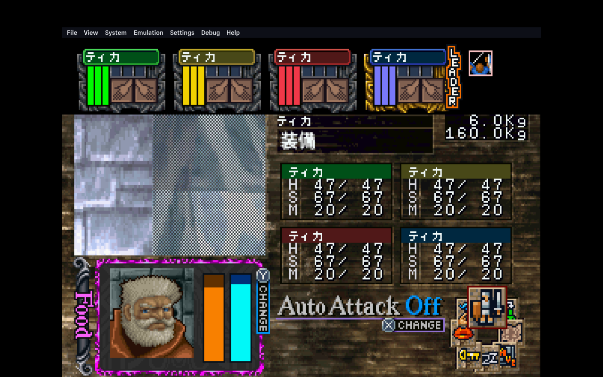
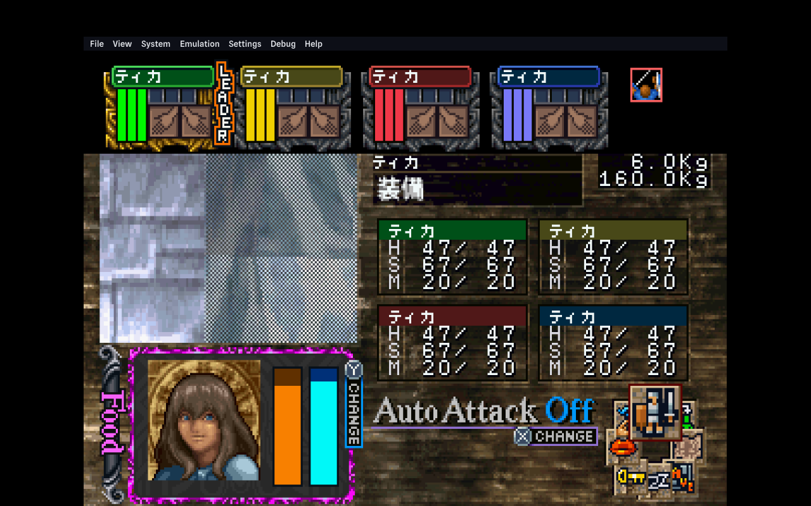

# Nexus retail leader cycling in Ymir `--debug` (2026-10-25)

## Setup

- Ymir 0.4.1, launched with `--debug` on TRV2.
- Authentic Japanese retail Nexus disc and Saturn BIOS.
- Private Ymir profile; Port 1 configured as Saturn ControlPad.
- The profile maps keyboard Q to L and E to R.
- No BUP change was made during the observation.

## Observation

From the retail party screen, Q/L moved the orange LEADER marker from the
first (green) champion to the fourth (blue) champion and changed the portrait
to that champion. E/R returned the marker to the first champion. The images
below are direct screenshots of the retail game in Ymir.

This confirms visible retail L/R leader cycling. It does not identify the
specific guest RAM field that owns leader state, nor does it establish mouse
hit regions or inventory behavior. Firestaff uses its existing Tab cycle
champion command for keyboard leader cycling in the loaded Nexus dungeon.
